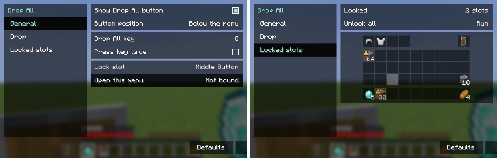

<p align="center">
  
</p>

<h1 align="center">Inventory Drop All</h1>

<p align="center">
  One button, and your whole inventory is out.<br>
  Armor and locked slots stay where they are.
</p>

<p align="center">
  <a href="https://github.com/Lenno70270/inventory-drop-all/releases/latest"></a>
  
  
  
  
</p>

---


<sub>The button below the inventory and below a chest. Slots with a padlock are never dropped. In-game screenshots.</sub>

## How to use

| Input | What happens |
| --- | --- |
| **Drop All** button in your inventory | Drops everything that isn't locked |
| **Middle mouse button** on a slot | Lock or unlock the slot, locked slots show a padlock |
| Your own key (unbound by default) | Drop everything without clicking the button |
| Your own key (unbound by default) | Open the Drop All menu |

The keys are under Options, Controls, Key Binds in the "Drop All" category.

## Settings

Via the gear next to the button or in [Mod Menu](https://modrinth.com/mod/modmenu):



- **General:** show the button, its position (below the inventory or to the right), keys, and a safety check (the key
  only drops on the second press)
- **Drop:** hotbar, inventory, offhand, armor (armor is off by default)
- **Locked slots:** lock slots right in the grid, or unlock all at once

Settings are stored in `config/dropallplus.json`, locked slots in `config/dropallplus-locks.txt`.

In the creative inventory, Drop All does nothing on purpose, because the server throttles creative drops and items
could disappear.

The mod is available in English and German, depending on your game language.

## Installation

1. Install [Fabric Loader](https://fabricmc.net/use/) for Minecraft 26.2 or 26.3 (Java 25)
2. Put [Fabric API](https://modrinth.com/mod/fabric-api) into your `mods` folder
3. Add the matching file from the [releases](https://github.com/Lenno70270/inventory-drop-all/releases/latest):
   `…+mc26.2.jar` for 26.2, `…+mc26.3.jar` for 26.3

[Mod Menu](https://modrinth.com/mod/modmenu) is optional and adds the gear to the mod list.

## Building

Mod Menu is only needed to compile and isn't in the repository. Download `modmenu-20.0.3.jar` from
[Modrinth](https://modrinth.com/mod/modmenu) and put it into `libs/`. Then:

```bash
./gradlew build          # for 26.2
./gradlew build -Pmc=26.3
```

The finished file is in `build/libs/`.

## License

MIT, see [LICENSE](LICENSE).
