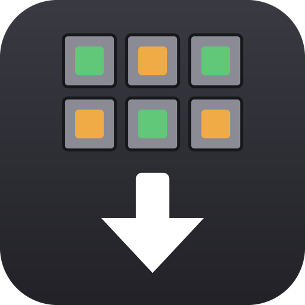
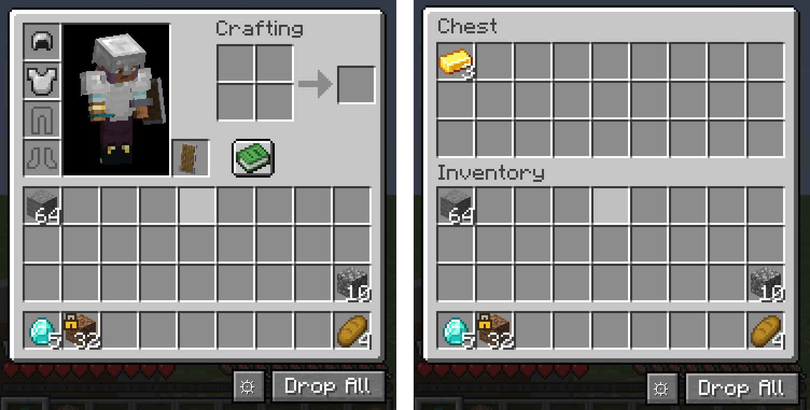
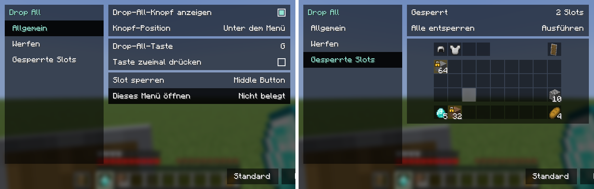

<p align="center">
  
</p>

<h1 align="center">Inventory Drop All</h1>

<p align="center">
  Ein Knopf, und dein ganzes Inventar fliegt raus.<br>
  Rüstung und gesperrte Slots bleiben, wo sie sind.
</p>

<p align="center">
  <a href="https://github.com/Lenno70270/inventory-drop-all/releases/latest"></a>
  
  
  
  
</p>

> **English:** A **Drop All** button in every inventory screen throws your whole inventory and hotbar at once.
> Armor and locked slots stay. Client-side, works on any server.

---



<sub>Der Knopf unter dem Inventar und unter einer Kiste. Die Slots mit dem Schloss werden nicht geworfen.
Screenshots aus dem Spiel.</sub>

## Bedienen

| Eingabe | Was passiert |
| --- | --- |
| Knopf **Drop All** im Inventar | Wirft alles, was nicht gesperrt ist |
| **Mittlere Maustaste** auf einen Slot | Slot sperren oder entsperren, gesperrte Slots bekommen ein Schloss |
| Eigene Taste (frei belegbar) | Ganzes Inventar werfen, ohne den Knopf zu klicken |
| Eigene Taste (frei belegbar) | Drop-All-Menü öffnen |

Die Tasten stehen unter Optionen, Steuerung, Tastenbelegung in der Kategorie „Drop All“.

## Einstellungen

Über das Zahnrad neben dem Knopf oder in [Mod Menu](https://modrinth.com/mod/modmenu):



- **Allgemein:** Knopf anzeigen, Position (unter dem Inventar oder rechts daneben), Tasten, Sicherheitsabfrage
  (erst beim zweiten Drücken wird geworfen)
- **Werfen:** Hotbar, Inventar, Zweithand, Rüstung (Rüstung ist standardmäßig aus)
- **Gesperrte Slots:** Slots direkt im Raster sperren oder alle auf einmal entsperren

Die Einstellungen liegen in `config/dropallplus.json`, gesperrte Slots in `config/dropallplus-locks.txt`.

Im Kreativ-Inventar wirft Drop All bewusst nichts, weil der Server Kreativ-Drops drosselt und Items sonst
verschwinden würden.

## Installation

1. [Fabric Loader](https://fabricmc.net/use/) für Minecraft 26.2 oder 26.3 installieren (Java 25)
2. [Fabric API](https://modrinth.com/mod/fabric-api) in den `mods`-Ordner legen
3. Die passende Datei aus den [Releases](https://github.com/Lenno70270/inventory-drop-all/releases/latest) dazulegen:
   `…+mc26.2.jar` für 26.2, `…+mc26.3.jar` für 26.3

[Mod Menu](https://modrinth.com/mod/modmenu) ist optional und bringt das Zahnrad in der Mod-Liste.

## Bauen

Mod Menu wird nur zum Kompilieren gebraucht und liegt nicht im Repository. Lade `modmenu-20.0.3.jar` von
[Modrinth](https://modrinth.com/mod/modmenu) und leg sie nach `libs/`. Dann:

```bash
./gradlew build          # für 26.2
./gradlew build -Pmc=26.3
```

Die fertige Datei liegt danach in `build/libs/`.

## Lizenz

MIT, siehe [LICENSE](LICENSE).
